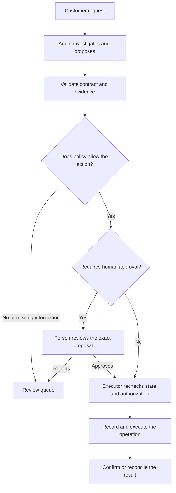
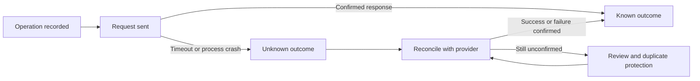

The agent finished the task. The APIs responded, the JSON was valid, and the dashboard was all green.

There was just one detail: it suggested refunding a purchase that had already been refunded.

Nothing went down. Something still went wrong.

In [Design for Failure: wait, my system fails?](/posts/design-for-failure/), I covered retries, fallbacks, circuit breakers, and sagas. The question was what happens to the rest of the system when a dependency fails. Those patterns still apply. Putting an agent in the path does not fix the network, eliminate timeouts, or make a payment safe to repeat.

But it adds another question: **what happens when the dependencies work and the decision is wrong?**

That is where I want to pick up the conversation. Without explaining all the same patterns again, or turning every application into a collection of agents.

## An error does not always come with a 500

Let's use a fictional example: a support assistant that investigates refund requests for a store.

It can read the customer's request, look up the order, and prepare a proposal. The customer says they were charged twice. The assistant needs to determine whether there are two charges, two payment attempts, or one charge and a refund that is still processing.

These situations should not lead to the same action.

This problem did not start with AI. A traditional service can also return `200 OK` with the wrong calculation. The difference here is giving the model some control over the next step: what to look up, which evidence to consider, and when to finish the investigation.

Mallika Rao describes this shift as moving from decomposing functionality to [decomposing decisions](https://www.infoq.com/articles/distributed-systems-microservices-agentic-ai/). I find that a useful lens, not a requirement to migrate architectures.

In practice, it helps to separate three questions:

| Layer | Question | What could still be wrong |
| --- | --- | --- |
| Transport | Did the call respond within the deadline? | The response might refer to the wrong purchase. |
| Contract | Does the result have the expected fields and types? | A value might be well formed but violate the refund policy. |
| Business | Does the proposal make sense given the current evidence? | There might not be enough information to decide safely. |

Validating the JSON answers the second question. It does not answer the third.

And asking the agent how confident it feels is no substitute for checking the payment's state.

## A wrong decision can propagate too

Imagine this sequence:

1. The assistant reads an old order summary.
2. The summary does not show the refund that was just initiated.
3. The assistant interprets this as an unresolved charge.
4. Another step receives that interpretation as if it were a confirmed fact.
5. The system prepares another refund.

There was no connection failure. A wrong premise traveled through the workflow.

Rao's article discusses cascading decision degradation, context inconsistency, and quality loss without an explicit infrastructure error. This does not mean every long sequence will fail. It means availability alone leaves out an important part of the story.

For this assistant, I would separate **evidence** from **interpretation**. A proposal should identify which records were consulted, when they were read, and which rule was applied. We do not need a transcript of the model's internal reasoning. We need a trail we can verify.

And before moving money, the executor should check the relevant state again. Evidence that was correct during the investigation might be stale by the time the action runs.

## The agent proposes. The system controls what can run

The most important separation in this design is not between two agents. It is between **preparing an action** and **having authority to execute it**.



*Reading the diagram: controls outside the model check the proposal. Even an approval does not replace the executor's final checks.*

In this example, business policy remains in code and data controlled by the application. It checks identity, order, payment, the amount available to refund, and the approval required for that operation.

A person approves a specific proposal with a defined order and amount. If the agent changes the proposal afterward, the previous approval does not cover the new action.

I covered permissions in [Guardrails and Fitness Functions for AI-Friendly Architecture](/posts/guardrails-and-fitness-functions-for-ai-friendly-architecture/). The reliability consequence here is straightforward: a wrong suggestion should not automatically become an external side effect.

This does not prove the policy is correct. It also needs tests and review. The benefit is having an explicit, verifiable rule that does not depend on the agent's interpretation.

## The timeout needs to cover the whole task

Each call can have a timeout while the overall task has no limit.

The model queries a tool, dislikes the result, queries another one, asks for a review, revises the plan, and starts again. Every call respects its own deadline. The customer keeps waiting.

That is why I would define a budget for the entire execution, in addition to each dependency's timeout. Anthropic recommends [stopping conditions such as a maximum number of iterations](https://www.anthropic.com/engineering/building-effective-agents), and highlights the costs and errors that can accumulate in autonomous agents.

An illustrative contract might look like this:

```yaml
# Example policy, not a framework configuration.
execution_budget:
  deadline_seconds: 20
  max_model_calls: 4
  max_tool_calls: 6
  on_exhaustion: review_queue
```

These numbers are made up to illustrate the format. They are neither test results nor production recommendations.

What matters is who owns the counter. The budget belongs to the execution, not the prompt. Replanning should not reset it. Delegated calls also need to consume that budget, including attempts made in lower layers.

I would also separate per-task limits from service-wide limits. Many small tasks can still saturate a dependency. A dedicated queue and a concurrency cap for investigations help limit competition with normal support traffic. They are not enough if both paths still compete without limits for the same database or connection pool.

And remember: the deadline expired for the caller. That does not prove a remote operation was canceled.

## A transport retry is not a new business decision

The [Amazon Builders' Library](https://aws.amazon.com/builders-library/timeouts-retries-and-backoff-with-jitter/) explains two precautions that remain especially useful here: retries at several layers multiply load, and a timeout does not mean the call had no side effects.

With agents, I would distinguish three things:

- **Transport retry:** repeat the same query after a transient failure, within that API's policy.
- **Proposal revision:** gather additional evidence because the conclusion does not yet meet the criteria.
- **New business operation:** initiate another refund. That is not a harmless retry.

If the workflow makes up to three attempts, the tool up to three, and the HTTP client up to three, the worst case for that composition is `3 × 3 × 3 = 27` attempts against the dependency. The count includes the initial attempt at each layer. This is arithmetic, not a measurement.

Giving every repetition a different name does not reduce the load. The system needs an explicit policy for where to retry, and a shared limit that accounts for the actual work.

For external side effects, the operation's identity must also survive retries. The trusted layer creates and persists that identity. The model should not invent another one on each attempt.

[Stripe's idempotency documentation](https://docs.stripe.com/api/idempotent_requests) provides a concrete example of this contract. In API v1, repeating a request with the same key returns the saved result after endpoint execution begins, and different parameters are rejected. The documentation also describes the retention limits for these keys.

This is not a universal guarantee of exactly-once execution. We need to respect the provider's contract and retention window, as well as control duplicates in our own domain.

And idempotency does not fix intent: the wrong refund is still wrong even if it happens only once.

## A fallback is not asking another model to try its luck

Switching models might be an availability choice. But if the problem is missing payment evidence, another model will not make that evidence appear.

For the store's assistant, the fallback would be more modest:

- tell the customer the investigation is not complete;
- preserve the information needed to resume the case;
- send the proposal and evidence to a review queue;
- do not create another refund while the previous outcome is unresolved.

This is a reduction in capability: the system stops resolving the case on its own, but can still explain what happened and what is missing.

The queue also needs an owner, capacity, deadlines, and alerts. Sending everything to humans without watching the backlog only moves the problem elsewhere.

The same reasoning applies to a circuit breaker, which stops calls to a dependency after a failure threshold. A timeout-based circuit can protect the API while still letting bad proposals through with fast responses. If quality criteria are no longer being met, I would suspend automatic execution for that workflow through a separate policy. I would not wait for a `500`.

## An unknown outcome deserves its own state

Here is the case I would most want to see in the tests: the executor sends the refund, the provider accepts it, and the response is lost.

What does the system know?

It does not know that the operation failed. **It knows it has not yet confirmed the outcome.**



*Reading the diagram: losing the response leads to reconciliation, not automatically creating another operation.*

The executor should record the intent and its identity before sending the request. This helps recovery after a process crash, but does not create an atomic transaction between the local database and the provider.

On resumption, it uses the available contract: remote status queries, provider events, or a safe retry with the same key where supported. While the outcome remains unknown, the case should not acquire a second, conflicting operation. That requires concurrency control in storage, not just an instruction in the prompt.

This is the consistency and recovery discussion from the first article, applied to the boundary between decision and side effect. A compensation is another operation that can fail too. And not every effect can be undone: a later payment reversal does not erase the incorrect message already sent to the customer.

## Test the failures before granting autonomy

I would start with a small set of scenarios and explicit expectations:

| Injected failure | Expected behavior |
| --- | --- |
| Stale or contradictory evidence | Automatic execution is blocked, and missing information is made visible. |
| A well-formed proposal that violates policy | The executor rejects the action before any external side effect. |
| The global limit is reached during replanning | The task stops without resetting the budget. |
| A response is lost after an operation is accepted | The case enters reconciliation without creating another identity. |
| The process crashes after sending but before saving the response | Recovery treats the outcome as unknown. |
| Two executions act on the same case | Concurrency control prevents conflicting refunds. |
| Approval exists, but state changes before execution | The executor revalidates and stops the action if necessary. |
| Cases accumulate in the fallback queue | Queue limits and alerts make the degradation visible. |

This table is a proposed test plan. This article does not describe an executed lab or measured results.

Naresh Jain describes a useful separation between guidance and executable checks in [Are Harnesses Worth the Cost?](https://martinfowler.com/articles/are-harnesses-worth-the-cost.html). His experiment concerns coding agents, not this support assistant. The connection that matters here is verifying contracts and observable effects independently of the agent's claim that it has finished.

Testing the final sentence is not enough. We need to check what was read, what was blocked, and what actually changed.

## Observe outcomes and roll out gradually

In [Agent Observability with OpenTelemetry](/posts/agent-observability-with-opentelemetry/), I discussed connecting activity to outcomes. For this workflow, I would add a few questions to the dashboard:

- How many proposals did policy reject, and why?
- How many tasks stopped because evidence or budget was missing?
- How many operations have unknown outcomes, and for how long?
- How many cases await review, and how many did a person correct?
- Among reviewed cases, which types of errors appear after a change?

A rejection does not prove the agent got worse: the incoming requests might have changed. A small queue does not prove quality either: perhaps the system is accepting what it should block. These signals need context and case review, including review of approved cases.

I would record model, prompt, and policy versions, along with the references needed to investigate each operation, with defined access and retention. I would not put customer data in metric labels or store every prompt by default.

Before taking actions, the workflow could operate in **shadow mode**: prepare proposals for comparison without write authorization. This mode still consumes resources and accesses data, so it also needs limits.

Next, human review of proposals. Only then, if the evidence supports it, automatic execution within a scope approved by the business, with a way to turn it off without interrupting conventional support. Disabling autonomy prevents new actions; it does not undo actions that already happened.

## The system needs to know when to stop

I still like the idea of naming the patterns we already use. Timeouts, retries, fallbacks, and recovery did not lose their value because a model joined the workflow.

But the scope has grown. Besides preventing a dependency from bringing the system down, we need to prevent a bad conclusion from gaining authority, repeating without limits, and causing a side effect nobody can explain afterward.

For me, Design for Failure with agents starts here: **define what can be decided, verify what can be executed, and know what to do when the task cannot be completed.**

Sometimes the most reliable decision is not to decide alone.
