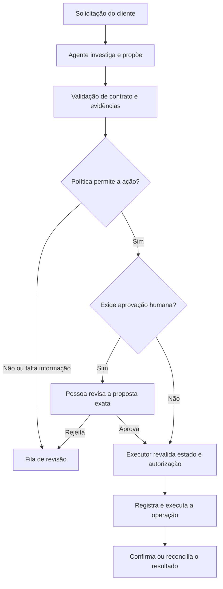
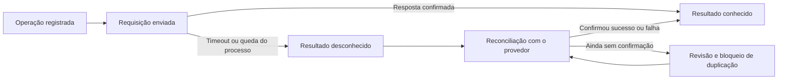

O agente terminou a tarefa. As APIs responderam, o JSON estava válido e o painel ficou todo verde.

Só tinha um detalhe: ele sugeriu devolver o dinheiro de uma compra que já tinha sido estornada.

Nada caiu. Mesmo assim, deu errado.

No artigo [Design for Failure: como assim meu sistema falha?](/pt-br/posts/design-for-failure/), falei de retry, fallback, circuit breaker e saga. A pergunta era o que acontece com o resto do sistema quando uma dependência falha. Os padrões continuam valendo. Colocar um agente no caminho não conserta rede, não elimina timeout e não torna uma cobrança segura para repetir.

Mas acrescenta uma pergunta: **o que acontece quando as dependências funcionam e a decisão está errada?**

É por aí que quero continuar aquela conversa. Sem reescrever os mesmos padrões, e sem transformar toda aplicação em um conjunto de agentes.

## O erro nem sempre vem com um 500

Vamos usar um exemplo fictício: um assistente de atendimento que investiga pedidos de reembolso em uma loja.

Ele pode ler a solicitação do cliente, consultar o pedido e preparar uma proposta. O cliente diz que foi cobrado duas vezes. O assistente precisa descobrir se existem duas cobranças, duas tentativas de pagamento ou uma cobrança e um estorno ainda em processamento.

Essas situações não deveriam levar à mesma ação.

O problema não começa com IA. Um serviço tradicional também pode devolver `200 OK` com o cálculo errado. A diferença, neste recorte, é colocar parte da escolha do próximo passo nas mãos do modelo: o que consultar, qual evidência considerar e quando concluir a investigação.

Mallika Rao descreve essa mudança como passar da decomposição de funcionalidades para a [decomposição de decisões](https://www.infoq.com/articles/distributed-systems-microservices-agentic-ai/). Acho uma lente útil, não uma obrigação de migrar de arquitetura.

Na prática, vale separar três perguntas:

| Camada | Pergunta | O que ainda pode estar errado |
| --- | --- | --- |
| Transporte | A chamada respondeu no prazo? | A resposta pode se referir à compra errada. |
| Contrato | O resultado tem os campos e tipos esperados? | Um valor pode estar bem formado e violar a política de reembolso. |
| Negócio | A proposta faz sentido com as evidências atuais? | Pode faltar informação para decidir com segurança. |

Validar o JSON resolve a segunda pergunta. Não resolve a terceira.

E pedir ao próprio agente que diga se está confiante não substitui consultar o estado do pagamento.

## Uma decisão errada também se propaga

Imagine esta sequência:

1. O assistente consulta um resumo antigo do pedido.
2. O resumo não mostra o estorno que acabou de ser iniciado.
3. O assistente interpreta isso como uma cobrança ainda não resolvida.
4. Outra etapa recebe essa interpretação como se fosse um fato confirmado.
5. O sistema prepara um novo reembolso.

Não houve falha de conexão. Houve uma premissa errada viajando pelo fluxo.

O artigo de Rao discute justamente a degradação em cascata de decisões, a inconsistência de contexto e a perda de qualidade sem um erro explícito de infraestrutura. Isso não significa que toda sequência longa falhará. Significa que observar apenas disponibilidade deixa uma parte importante da história de fora.

Para este assistente, eu separaria **evidência** de **interpretação**. Uma proposta deveria apontar quais registros foram consultados, quando foram lidos e qual regra foi aplicada. Não precisa guardar uma transcrição do raciocínio interno do modelo. Precisa deixar uma trilha verificável.

E, antes de movimentar dinheiro, o executor deve consultar novamente o estado relevante. Uma evidência correta durante a investigação pode estar desatualizada na hora da execução.

## O agente propõe. O sistema decide o que pode executar

A separação mais importante deste desenho não é entre dois agentes. É entre **preparar uma ação** e **ter autoridade para executá-la**.



*Leitura do diagrama: a proposta passa por controles fora do modelo. Mesmo uma aprovação não dispensa a verificação final do executor.*

Neste exemplo, a política de negócio continua em código e dados controlados pela aplicação. Ela verifica identidade, pedido, pagamento, valor disponível para reembolso e a aprovação exigida para aquela operação.

Uma pessoa aprova uma proposta específica, com pedido e valor definidos. Se o agente mudar a proposta depois, a aprovação anterior não vale para a nova ação.

Já discuti a parte de permissões em [Guardrails e Fitness Functions para uma Arquitetura Amigável à IA](/pt-br/posts/guardrails-and-fitness-functions-for-ai-friendly-architecture/). Aqui a consequência para a confiabilidade é direta: uma sugestão errada não deve virar automaticamente um efeito externo.

Isso não prova que a política está correta. Ela também precisa de testes e revisão. A vantagem é ter uma regra explícita, verificável e independente da interpretação do agente.

## O timeout agora precisa abraçar a tarefa

Uma chamada pode ter timeout e a tarefa inteira continuar sem limite.

O modelo consulta uma ferramenta, não gosta do resultado, consulta outra, pede uma revisão, reformula o plano e começa de novo. Cada chamada respeita seu próprio prazo. O cliente continua esperando.

Por isso, além do timeout de cada dependência, eu definiria um orçamento para a execução inteira. A Anthropic recomenda [condições de parada, como um máximo de iterações](https://www.anthropic.com/engineering/building-effective-agents), e ressalta os custos e os erros que podem se acumular em agentes autônomos.

Um contrato didático poderia ser:

```yaml
# Exemplo de política, não configuração de um framework.
execution_budget:
  deadline_seconds: 20
  max_model_calls: 4
  max_tool_calls: 6
  on_exhaustion: review_queue
```

Esses números são inventados para ilustrar o formato. Não são um resultado de teste nem uma recomendação para produção.

O importante é quem controla o contador. O orçamento pertence à execução, não ao prompt. Replanejar não deve zerá-lo. Uma chamada delegada também precisa consumir esse orçamento, incluindo as tentativas feitas abaixo dela.

Eu também separaria os limites por tarefa dos limites do serviço inteiro. Várias tarefas pequenas ainda podem saturar uma dependência. Uma fila própria e um teto de concorrência para a investigação ajudam a limitar a disputa com o fluxo normal de atendimento. Não bastam se ambos continuarem disputando, sem limite, o mesmo banco ou pool de conexões.

E atenção: o prazo acabou para quem está esperando. Isso não prova que uma operação remota foi cancelada.

## Retry de transporte não é uma nova decisão de negócio

A [Amazon Builders' Library](https://aws.amazon.com/builders-library/timeouts-retries-and-backoff-with-jitter/) explica dois cuidados que continuam especialmente úteis aqui: retries em várias camadas multiplicam a carga, e um timeout não significa que o efeito da chamada deixou de acontecer.

Com agentes, eu separaria três coisas:

- **Retry de transporte:** repetir a mesma consulta após uma falha transitória, dentro da política daquela API.
- **Revisão da proposta:** buscar evidência adicional porque a conclusão ainda não atende aos critérios.
- **Nova operação de negócio:** iniciar outro reembolso. Isso não é um retry inofensivo.

Se o fluxo fizer até três tentativas, a ferramenta até três e o cliente HTTP até três, o pior caso dessa composição é `3 × 3 × 3 = 27` tentativas na dependência. A conta inclui a primeira tentativa de cada camada. É um exemplo aritmético, não uma medição.

Dar um nome diferente a cada repetição não reduz a carga. O sistema precisa de uma política explícita sobre onde retentar e de um limite compartilhado que enxergue o trabalho real.

Para efeitos externos, a identidade da operação também precisa sobreviver à repetição. A camada confiável cria e persiste essa identidade. Não cabe ao modelo inventar outra a cada tentativa.

A [documentação de idempotência da Stripe](https://docs.stripe.com/api/idempotent_requests) mostra um exemplo concreto desse contrato. Na API v1, repetir uma requisição com a mesma chave retorna o resultado salvo depois que a execução do endpoint começa, e parâmetros diferentes são rejeitados. A documentação também descreve os limites de retenção dessas chaves.

Não é uma garantia universal de execução única. É preciso respeitar o contrato e a janela de retenção do provedor, além de controlar duplicações no próprio domínio.

E idempotência não corrige a intenção: um reembolso errado continua errado mesmo que seja realizado uma única vez.

## Fallback não é pedir para outro modelo tentar a sorte

Trocar de modelo pode ser uma escolha de disponibilidade. Mas, se o problema é falta de evidência sobre o pagamento, outro modelo não faz essa evidência aparecer.

Para o assistente da loja, o fallback seria mais modesto:

- informar que a análise ainda não foi concluída;
- preservar os dados necessários para retomar o caso;
- encaminhar a proposta e as evidências para uma fila de revisão;
- não criar um novo reembolso enquanto o estado anterior estiver indefinido.

É uma degradação de capacidade: o sistema deixa de resolver sozinho, mas continua explicando o que aconteceu e o que falta.

A fila também precisa de dono, capacidade, prazo e alerta. Encaminhar tudo para humanos sem observar o acúmulo só muda o endereço do problema.

O mesmo raciocínio vale para o circuit breaker, o mecanismo que interrompe chamadas a uma dependência após um limite de falhas. Um circuito baseado em timeouts pode proteger a API e ainda deixar passar propostas ruins com respostas rápidas. Se os critérios de qualidade deixaram de ser atendidos, eu suspenderia a execução automática daquele fluxo por uma política separada. Não esperaria aparecer um `500`.

## Resultado desconhecido merece um estado próprio

Aqui está o caso que eu mais gostaria de ver nos testes: o executor envia o reembolso, o provedor aceita e a resposta se perde.

O que o sistema sabe?

Não sabe que falhou. **Sabe que ainda não conseguiu confirmar o resultado.**



*Leitura do diagrama: perder a resposta leva à reconciliação, não à criação automática de outra operação.*

O executor deve registrar a intenção e sua identidade antes de enviar a requisição. Isso ajuda na recuperação se o processo cair, mas não cria uma transação atômica entre o banco local e o provedor.

Ao retomar, ele usa o contrato disponível: consulta do estado remoto, eventos do provedor ou repetição segura com a mesma chave, quando suportada. Enquanto o resultado continuar desconhecido, o caso não deve ganhar uma segunda operação incompatível. Isso exige controle de concorrência no armazenamento, não só uma instrução no prompt.

É a conversa sobre consistência e recuperação do primeiro artigo, aplicada à fronteira entre decisão e efeito. Uma compensação também é outra operação que pode falhar. E nem todo efeito pode ser desfeito: um estorno posterior não apaga a mensagem incorreta que já foi enviada ao cliente.

## Testar a falha antes de liberar a autonomia

Eu começaria com uma bateria pequena de cenários e expectativas explícitas:

| Falha provocada | Comportamento esperado |
| --- | --- |
| Evidência antiga ou contraditória | A execução automática é bloqueada e a informação faltante fica visível. |
| Proposta bem formada, mas fora da política | O executor rejeita a ação antes do efeito externo. |
| Limite global atingido durante um replanejamento | A tarefa para sem reiniciar o orçamento. |
| Resposta perdida depois de uma operação aceita | O caso entra em reconciliação sem gerar outra identidade. |
| Processo cai depois do envio e antes de gravar a resposta | A retomada trata o resultado como desconhecido. |
| Duas execuções atuam sobre o mesmo caso | O controle de concorrência impede reembolsos incompatíveis. |
| Aprovação existe, mas o estado mudou antes da execução | O executor revalida e interrompe a ação se necessário. |
| Fallback começa a acumular casos | O limite e o alerta da fila tornam a degradação visível. |

Essa tabela é uma proposta de testes. Não há um laboratório executado nem resultados medidos neste artigo.

Naresh Jain descreve uma separação útil entre orientação e verificações executáveis em [Are Harnesses Worth the Cost?](https://martinfowler.com/articles/are-harnesses-worth-the-cost.html). O experimento é sobre agentes de programação, não sobre este assistente de atendimento. A conexão que me interessa é verificar contratos e efeitos observáveis por uma fonte independente da afirmação de que o agente terminou.

Não basta testar a frase final. É preciso conferir o que foi consultado, o que foi bloqueado e o que realmente mudou.

## Observar o resultado e liberar aos poucos

No artigo sobre [observabilidade de agentes com OpenTelemetry](/pt-br/posts/agent-observability-with-opentelemetry/), discuti como ligar atividade a resultado. Para este fluxo, eu acrescentaria algumas perguntas ao painel:

- Quantas propostas foram rejeitadas pela política, e por quê?
- Quantas tarefas pararam por falta de evidência ou de orçamento?
- Quantas operações estão com resultado desconhecido, e há quanto tempo?
- Quantos casos esperam revisão, e quantos foram corrigidos por uma pessoa?
- Entre os casos revisados, quais tipos de erro aparecem depois de uma mudança?

Uma rejeição não prova que o agente piorou: o conjunto de solicitações pode ter mudado. Uma fila pequena também não prova qualidade: talvez o sistema esteja aceitando o que deveria bloquear. Os sinais precisam de contexto e de revisão de casos, inclusive dos que foram aprovados.

Eu registraria versões do modelo, do prompt e da política, além das referências necessárias para investigar cada operação, com acesso e retenção definidos. Não colocaria dados do cliente em rótulos de métricas nem guardaria todos os prompts por padrão.

Antes de executar ações, o fluxo poderia trabalhar em **modo sombra**: preparar propostas para comparação, sem autorização de escrita. Esse modo ainda consome recursos e acessa dados, então também precisa de limites.

Depois, revisão humana das propostas. Só então, se as evidências justificarem, execução automática em um recorte aprovado pelo negócio, com uma forma de desligá-la sem interromper o atendimento convencional. Desligar a autonomia impede novas ações; não desfaz as que já aconteceram.

## O sistema precisa saber parar

Continuo gostando da ideia de dar nome aos padrões que a gente já usa. Timeout, retry, fallback e recuperação não perderam valor porque agora existe um modelo no fluxo.

Mas o alvo ficou maior. Além de impedir que uma dependência derrube o sistema, precisamos impedir que uma conclusão ruim ganhe autoridade, se repita sem limite e produza um efeito que ninguém consegue explicar depois.

Para mim, Design for Failure com agentes começa assim: **definir o que pode ser decidido, verificar o que pode ser executado e saber o que fazer quando não dá para concluir.**

Às vezes, a decisão mais confiável é não decidir sozinho.
